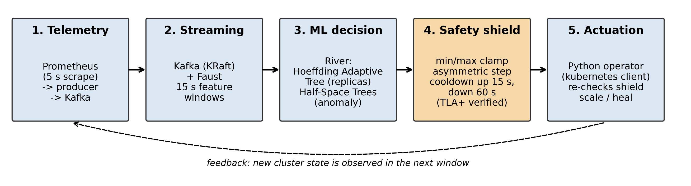

# SHIELD-AI: Safety-Aware Online-Learning Kubernetes Autoscaling

SHIELD-AI is a Kubernetes autoscaling and self-healing controller. It combines **online machine learning** with a **runtime safety shield whose rules are formally verified in TLA+**. The model proposes; the shield decides what may reach the cluster.



| Layer | Implementation |
|---|---|
| 1. Telemetry | Prometheus (5 s scrape) → metrics producer → Kafka |
| 2. Streaming | Kafka (KRaft) + Faust, 15 s feature windows |
| 3. ML decision | River Hoeffding Adaptive Tree (replica forecast), Half-Space Trees (anomaly score) |
| 4. Safety shield | Replica bounds, asymmetric step limit, direction-aware cooldowns, heal-keeps-replicas; verified with TLC |
| 5. Actuation | Python operator (official Kubernetes client); re-validates every decision against the live replica count |

---

## Key results

All numbers are from the files linked; the full evidence index is [`Paper/REVIEW_EVIDENCE/README.md`](Paper/REVIEW_EVIDENCE/README.md).

### Formal verification (TLA+ / TLC)
| Check | Result | Evidence |
|---|---|---|
| Safety: 5 invariants + 2 action properties, untrusted ML output 0–25 | **2,535,840 distinct states, no violation** (depth 28, 68 s) | [`specs/tlc_run_v2_safety.txt`](specs/tlc_run_v2_safety.txt) |
| Liveness: overload is eventually answered by a scale-up | **holds** (234,639 states) | [`specs/tlc_run_v2_liveness.txt`](specs/tlc_run_v2_liveness.txt) |
| Mutation testing: each shield rule disabled in turn | **7 / 7 mutants caught** | [`specs/tlc_run_v2_mutants.txt`](specs/tlc_run_v2_mutants.txt) |
| Unit and conformance tests | **80 passed** | `pytest tests` |

### Live evaluation: 75 runs (5 controllers × 3 scenarios × 5 seeds)
Four-node kind cluster, replicas 2–20, Locust load up to 1,006 req/s. Controllers: HPA, KEDA, a FIRM-inspired multi-threshold controller (MT), ML-only (no shield) and SHIELD-AI.

| Finding | Value | Significance (Mann–Whitney U, Holm) |
|---|---|---|
| Unsafe replica changes, ML-only → SHIELD-AI | **179 → 1** | p_Holm ≤ 0.039 in every scenario |
| Scale events per run, ML-only → SHIELD-AI | 13.6–15.0 → **7.6–9.0** | significant in every scenario |
| SLO-violation time vs HPA | lower in **15 / 15** seed–scenario pairs | large effect (δ −0.68 to −0.92), not significant at n = 5 |
| Under-provisioned time vs HPA (spike, diurnal) | 17–23 % vs 57–62 % (median) | p_Holm = 0.032 |
| Latency and SLO vs KEDA and MT | **on par** | no significant difference |
| Cost (replica-minutes) | higher than HPA and KEDA, similar to MT | trade-off, reported openly |
| Shield overhead | 55 µs per check; decision → actuation median 529 ms (537 ms without the shield) | [`pipeline_latency.json`](results_live/analysis/pipeline_latency.json) |

Full tables: [`results_live/analysis/RESULTS.md`](results_live/analysis/RESULTS.md). Per-seed hardware-blocked check: [`ROBUSTNESS.md`](results_live/analysis/ROBUSTNESS.md).

### Self-healing study
One pod is frozen (SIGSTOP) 60 s into constant load. Heal and no-heal arms have 15 runs each, the anomaly-gated arm and HPA 5 each, and 15 fault-free runs measure false heals. The analysis plan was fixed before the extension ([`PREREGISTRATION.md`](results_live/heal_analysis/PREREGISTRATION.md)).

| Arm (fault runs) | Runs | Heals (on frozen pod) | Median time over SLO | Median time to recover | Frozen pod left at end |
|---|---|---|---|---|---|
| SHIELD-AI (heal) | 15 | 10 (10) | 19.2 % | 18 s | 0/15 |
| SHIELD-AI (no heal) | 15 | — | 7.5 % | 17 s | 6/15 |
| SHIELD-AI (heal, anomaly-gated) | 5 | 0 | 89.4 % | 234 s | 5/5 |
| HPA | 5 | — | 100 % | 235 s | 5/5 |

- **Localisation works:** every heal targeted the frozen pod, with 0 false heals in 15 fault-free runs. The aggregate anomaly score never localised the fault.
- **No recovery benefit (pre-registered test):** 18 s vs 17 s, p = 0.95. Kubernetes deletes unready pods first on scale-down, so the autoscaler's scale-down removed the frozen pod in 9 of 15 no-heal runs.
- Two heals were blocked by the shield's shared cooldown. Five runs with a failed injection were excluded and repeated (see the deviation log).

---

## Repository layout

```
src/                     controller source
  kafka/  streaming/     metrics producer, Faust stream processor
  models/ decision/      River models, decision engine (scale / heal / noop)
  safety/                runtime safety shield (Python mirror of the TLA+ spec)
  kopf_operator/         actuator (Kubernetes API)
  baselines/             FIRM-inspired multi-threshold controller (MT)
specs/                   TLA+ specifications, TLC configs and outputs, safety policies
tests/                   unit and conformance tests
scripts/eval/live/       live evaluation harness (cluster setup, calibration, training, run matrix, analysis)
results_live/            raw data of all live runs + analysis outputs
  runs/ analysis/        scaling evaluation (75 runs) and its statistics
  heal_runs/             self-healing study (fault and fault-free runs)
  heal_analysis/         healing results, pre-registration and deviation log, run logs
  heal_pilots/           four pilot runs that settled the method (not counted)
  heal_runs_invalid/     five runs whose fault injection failed (excluded, kept as evidence)
Paper/REVIEW_EVIDENCE/   evidence package for the paper revision (one folder per reviewer topic)
Paper/figures/           paper figures and the scripts that generate them
ops/                     Docker image, kind config, Kubernetes manifests
docs/                    thesis, v1 paper, development log, archived v1 docs
```

---

## Reproduce

Requirements: Ubuntu 24.04 (or WSL2) with 4 vCPU / 16 GB, Docker, kind, kubectl, Helm, Python 3.11+, Java 11+.

```bash
bash bootstrap.sh                                   # install tooling
bash scripts/eval/live/setup_cluster.sh             # kind cluster, Prometheus, KEDA, Kafka, podinfo (~10 min)
bash scripts/eval/live/calibrate.sh                 # per-replica capacity -> calibration.env
bash scripts/eval/live/train_ml.sh                  # train models on a disjoint trace
SEEDS="1 2 3 4 5" bash scripts/eval/live/run_matrix.sh      # 75 live runs (~9 h on one VM)
python scripts/eval/live/analyze.py results_live/runs results_live/analysis
```

Self-healing study (after the cluster setup, calibration and training above):

```bash
SEEDS="1 2 3 4 5" bash scripts/eval/live/run_heal.sh                     # 4 arms with fault + 3 fault-free arms
ARMS="shield-heal shield-noheal" FAULTS=1 SEEDS="6 7 8 9 10 11 12 13 14 15" \n  bash scripts/eval/live/run_heal.sh                                     # pre-registered extension
python scripts/eval/live/analyze_heal.py results_live/heal_runs results_live/heal_analysis
python Paper/figures/make_fig_heal.py                                  # Fig. 5
```

Formal verification (download the TLA+ tools first, see [`tools/README.md`](tools/README.md)):

```bash
cd specs
java -cp ../tools/tla2tools.jar tlc2.TLC -config SafetyShieldV2_safety.cfg   SafetyShieldV2.tla
java -cp ../tools/tla2tools.jar tlc2.TLC -config SafetyShieldV2_liveness.cfg SafetyShieldV2.tla
```

Tests: `python -m pytest tests -q`

---

## Reviewer questions and answers

The paper was revised in response to a detailed review. Each comment is listed with its answer and the evidence behind it. Evidence paths are relative to [`Paper/REVIEW_EVIDENCE/`](Paper/REVIEW_EVIDENCE/README.md) unless they start with a top-level folder.

### 1. Missing evaluation
| Reviewer comment | Answer | Evidence |
|---|---|---|
| Describe the workloads and traffic scenarios | Three 360 s scenarios: spike, diurnal, bursty; seeded ±15 % noise; peak 1,006 req/s (≈ 16 replicas). Training uses a separate random-walk trace. | `scripts/eval/live/locust_scenarios.py`, `03_calibration_training/` |
| Define the metrics (SLO violations, latency, recovery, cost, oscillation) | SLO-violation time (p95 > 250 ms or errors > 1 %), p95/p99, error rate, reaction and recovery time, replica-minutes, oscillations, scale events, policy violations | `scripts/eval/live/analyze.py` |
| Results against HPA, KEDA and FIRM with repeated runs and statistics | 75 live runs, randomised order; mean ± SD; Mann–Whitney U with Holm correction and Cliff's δ; per-seed analysis for the two VM types | `04_live_experiments/analysis/` |
| Ablation: ML-only vs ML + shield | Same model with and without the shield: unsafe changes 179 → 1, scale events halved | `04_live_experiments/analysis/RESULTS.md` |
| "Matches KEDA on recovery, matches FIRM on safety" has no numbers | Removed; replaced by measured results | — |

### 2. Text from another paper (CPS / industrial control)
| Reviewer comment | Answer |
|---|---|
| Heading "Classification of Injection Attacks in CPS" | Removed |
| Actuator described as PLCs / remote terminal units | Rewritten: Python operator using the Kubernetes API |
| "SWaT for water treatment" in the conclusion | Removed |
| Reference [4] is a smart-grid survey | Replaced by Qu, Calheiros, Buyya, *ACM Computing Surveys* 51(4), 2018 |
| "SHEID-AI" typo | Corrected |

### 3. Text and figures contradict each other
| Reviewer comment | Answer | Evidence |
|---|---|---|
| Fig. 1 shows Flink and six layers; text says Faust and five | The system uses Faust; Fig. 1 redrawn with five layers | `src/streaming/stream_processor.py`, `Paper/figures/fig1_architecture.png` |
| "Threats to Validity" and "Section VI" promised but missing | Threats to Validity section added; the non-existent CI reference removed (CI listed as future work) | — |
| Cooldown 60 s encoded as `(clock − last) % 11 ≥ 6` | Old cyclic clock replaced by a saturating counter with explicit units: 1 tick = 15 s; cooldown up 15 s, down 60 s, identical in TLA+, YAML and Python | `01_formal_verification/` |
| "17 decisions per minute" vs a 60 s cooldown | Wrong: 17 decisions in ≈ 8 min (≈ 2.1/min). Removed | — |

### 4. Claims that did not hold
| Reviewer comment | Answer | Evidence |
|---|---|---|
| 273,702 states mixed up with 28 proposals | Separate experiments, now reported separately. New model: 2,535,840 states, no violation; 7/7 mutants caught | `01_formal_verification/` |
| "All 28 clamped or rejected", yet 6 passed | Recount: 12 modified, 10 rejected, 6 passed (already safe) → all 22 unsafe proposals corrected | `06_audit_recount/` |
| "Min-replica rule alone not responsible for 25 proposals" is unclear | Withdrawn. Per rule: step 11, min 1, max 0, heal 1, cooldown 9, unknown action 1, passed 6 | `06_audit_recount/recount_output.txt` |
| 9/17 cooldown rejections show throttling, not effectiveness | Agreed; claim removed. Effect of the shield now measured in the live ablation | `04_live_experiments/` |
| "100 % error in 9 of 9 runs" cites only an internal report | Raw data now shown (v1 table); root causes explained: label collapse, no-op resetting the cooldown, stale replica count, all fixed | `07_old_v1_evidence/` |

### 5. References
| Reviewer comment | Answer |
|---|---|
| [3], [8], [9], [11] are internal project files | Removed (two of the cited files did not exist) |
| FIRM attributed to "Lim et al." and described as rule-based | Corrected to Qiu et al., OSDI 2020 (SVM + RL); our baseline is labelled "FIRM-inspired" |
| [20] DOI points to another journal | Removed |
| [21]–[23] unrelated self-citations | Removed |
| [10], [12]–[14], [17]–[19] never cited | All remaining references are cited where used |

### 6. Language and presentation
| Reviewer comment | Answer |
|---|---|
| Language errors ("weather", "corn jobs", "Fauset", "hallucinate", "whi") | Full rewrite and proofreading |
| Ethics section in first person | Rewritten in the third person |
| No repository link despite "clone and reproduce in 90 minutes" | This repository; untested time claim removed; exact reproduction scripts listed |
| TLA+ spec, TLC configuration and Python enforcement code not shown | Added as Listings 1–3 in the paper |

### 7. Figures and tables
| Reviewer request | Answer | Evidence |
|---|---|---|
| Setup, scenarios, main comparison, ablation, per-invariant audit, TLC results, ML accuracy tables | All added (nine tables) | paper; `04_live_experiments/`, `06_audit_recount/`, `01_formal_verification/` |
| Replicas and load over time; latency / SLO | Timelines per scenario | `results_live/analysis/fig/timeline_*.png` |
| Anomaly detector ROC/PR and threshold justification | ROC-AUC 0.806, AP 0.950; threshold = p99 of training scores (1 % false-alarm budget). This analysis also showed that the old 2× heal gate was unreachable | `08_anomaly_detector/` |
| Kafka / latency overhead of the shield | Shield check 55 µs; decision → actuation median 529 ms with vs 537 ms without the shield | `05_shield_overhead/`, `09_pipeline_overhead/` |
| Scaling beyond 10 replicas / multi-node | Four-node cluster, replicas up to 20 | `04_live_experiments/analysis/per_run_metrics.csv` |

---

## Limitations
- The cluster is kind on a single VM per seed group; seeds 1–3 and 4–5 ran on two VM types (disclosed and blocked in the analysis).
- MT is a FIRM-*inspired* threshold controller, not the original RL-based FIRM.
- SLO and error improvements over the baselines have large effect sizes but are not statistically significant at n = 5.
- The aggregate anomaly detector does not flag single-pod failures; per-pod localisation does, but healing did not shorten recovery in our setup, because Kubernetes' scale-down removes unready pods first.

## License
[MIT](LICENSE)
